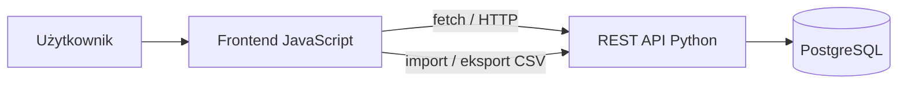

# Split Bills App

Prosta aplikacja webowa do zapisywania wspólnych wydatków i rozliczania rachunków w grupie. Projekt powstaje w ramach zajęć z języków skryptowych.

## Zakres

Planowane funkcje:

- tworzenie grupy i dodawanie do niej uczestników;
- zapisywanie rachunków z informacją, kto zapłacił i jak podzielić koszt;
- wyliczanie sald uczestników i kwot do rozliczenia;
- import rachunków z pliku CSV oraz eksport danych do CSV;
- walidacja danych i czytelne komunikaty o błędach.

Aplikacja ma pokazać prosty przepływ danych od interfejsu JavaScript, przez REST API w Pythonie, do bazy PostgreSQL. Szczegóły formatu CSV i podziału kosztów zostaną ustalone przed implementacją.

## Architektura

Backend będzie udostępniał endpoint `GET /health` do sprawdzania stanu API. Dane będą przechowywane w PostgreSQL; konfiguracja połączenia będzie przekazywana przez zmienną środowiskową.

## Technologie

- **Frontend:** JavaScript
- **Backend:** Python, REST API
- **Baza danych:** PostgreSQL (lokalnie lub Neon)
- **Testy:** pytest dla backendu i Vitest dla frontendu
- **Jakość kodu:** Ruff i ESLint

## Uruchomienie lokalne

Repozytorium jest na etapie przygotowania szkieletu aplikacji. Konkretne polecenia instalacji i uruchomienia zostaną dodane po ustaleniu struktury frontend/backend oraz konfiguracji bazy.

Do uruchomienia aplikacji lokalnie będzie potrzebna baza PostgreSQL i skonfigurowana zmienna środowiskowa z adresem połączenia. Nie należy umieszczać haseł ani innych sekretów w repozytorium.

## Testy i CI

Docelowo projekt będzie zawierał co najmniej 8 testów backendowych w pytest oraz 2 testy frontendu w Vitest. Workflow GitHub Actions będzie uruchamiał lint i testy przy zmianach w repozytorium.

## Wdrożenie

Plan wdrożenia:

- frontend: GitHub Pages;
- backend: Vercel;
- po wdrożeniu: sprawdzenie endpointu `/health`.

Linki do wdrożonej aplikacji i API zostaną dodane po ich opublikowaniu.

## Praca nad projektem

Prace są podzielone na pięć spotkań. Zadania i postęp zespołu są śledzone w GitHub Issues oraz milestone’ach repozytorium. Zmiany w kodzie powinny trafiać przez pull requesty.

Informacje o użyciu narzędzi AI w projekcie będą opisane w pliku [AI.md](AI.md).
